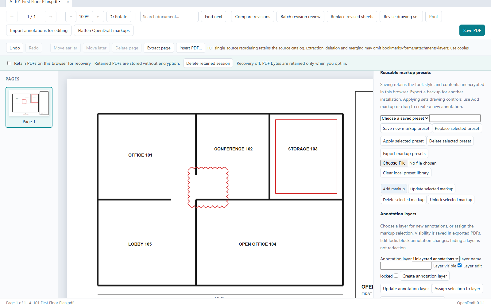

# OpenDraft

**Free, open-source PDF markup, measurement and takeoff for construction drawings — an alternative to Bluebeam Revu.**



No subscription, no account, no telemetry. Your PDFs stay on your computer unless you choose to run the optional self-hosted collaboration server.

> **Status: public test release (v0.1.1).** Everything below is implemented and covered by automated tests, but it has so far been tested on generated sample drawings, not a wide range of real-world project sets. Please try it on your drawings and [report anything that goes wrong](https://github.com/Hydrada/OpenDraft/issues). Keep copies of your originals.

## Download

Get the latest build from the [Releases page](https://github.com/Hydrada/OpenDraft/releases):

| File | What it is |
| --- | --- |
| `OpenDraft-<version>-win-x64-setup.exe` | Windows installer (Windows 10/11, 64-bit) |
| `OpenDraft-<version>-win.zip` | Portable Windows version, no install needed — unzip and run `OpenDraft.exe` |
| `opendraft-web-<version>.zip` | Browser version to host on any static web server |
| `opendraft-selfhost-<version>.zip` | Collaboration server for teams (Node.js) |

**Windows SmartScreen warning:** the installer is not code-signed yet, so Windows shows "Windows protected your PC". Click **More info → Run anyway**. You can verify downloads against the SHA-256 hashes listed in the release notes.

## What it does

**Viewing and organizing**
- Fast viewing of large drawing sets: tabs, thumbnails, search, bookmarks, layers, hyperlinks
- Insert, extract, delete, reorder and rotate pages
- Automatic sheet hyperlinks (references like `A-102` or `3/M201` become links)
- OCR to make scanned drawings searchable (English, Spanish, French, German — runs offline)

**Markups**
- Rectangles, ellipses, lines, arrows, polylines, clouds, callouts, text, highlights, ink
- Stamps: standard, custom, image/PDF artwork and dynamic stamps (`{date}`, `{author}`…)
- Markups list with status, author, filters, sorting, comment threads and punch lists
- CSV and PDF markup reports; layers, groups, locking and flattening
- Imports existing markups from PDFs created in other apps
- Reusable tool sets, shareable with your team

**Measurement and takeoff**
- Calibrate per page or per viewport; length, polyline, perimeter, area, angle, count, volume, radius, diameter, arc
- Snapping to drawing endpoints, midpoints and intersections; cutouts, dynamic fill, sketch to scale
- Quantity formulas and presets, takeoff legends and spaces
- Export to CSV/Excel, live Excel quantity links, and standard PDF measurement annotations

**Revisions and review**
- Overlay and side-by-side comparison with alignment, batch comparison of whole sets
- Automatic difference clouds, slip sheets and revision sets

**Documents**
- Fill and create PDF forms
- True redaction (content removed, not just covered)
- Digital signatures: sign, certify, timestamp, verify (trust, CRL/OCSP revocation, long-term validation)
- Vector printing at full printer resolution (desktop app)

**Teamwork (optional)**
- Self-hosted server for real-time shared markups, roles and permissions, presence, offline queueing, audit log and backups — see [Self-hosting](docs/SELF_HOSTING.md)

**Not supported:** 3D PDF models, editing the original text/graphics of a drawing, and encrypted or XFA-form PDFs. See [Known limitations](KNOWN_LIMITATIONS.md) for details.

## Reporting problems

Open an [issue](https://github.com/Hydrada/OpenDraft/issues/new/choose) with the steps to reproduce, your Windows version, and — if you can share it — the PDF. Never attach confidential drawings to a public issue.

## Building from source

Requires Node.js 24 and npm.

```powershell
npm ci
npm run dev                 # browser version at the printed localhost URL
npm run build               # production web build in apps/opendraft/dist
npm test                    # unit and integration tests
npx playwright install chromium firefox webkit
npm run desktop:runtime     # fetch the Electron runtime
npm run test:e2e            # browser and desktop tests
npm run desktop:package     # Windows installer and zip
```

More: [desktop packaging](docs/DESKTOP_PACKAGING.md), [static hosting](docs/STATIC_HOSTING.md), [self-hosting](docs/SELF_HOSTING.md), [collaboration](docs/COLLABORATION.md), [feature comparison with Revu](docs/research/FEATURE_GAP_MATRIX.md), [test results](TEST_RESULTS.md).

## License

[MIT](LICENSE). Third-party components and their licenses are listed in [desktop/THIRD_PARTY_NOTICES.md](desktop/THIRD_PARTY_NOTICES.md) and [docs/generated/DEPENDENCY_LICENSES.json](docs/generated/DEPENDENCY_LICENSES.json).

OpenDraft is an independent project and is not affiliated with or endorsed by Bluebeam, Inc. "Bluebeam" and "Revu" are trademarks of their respective owner.
